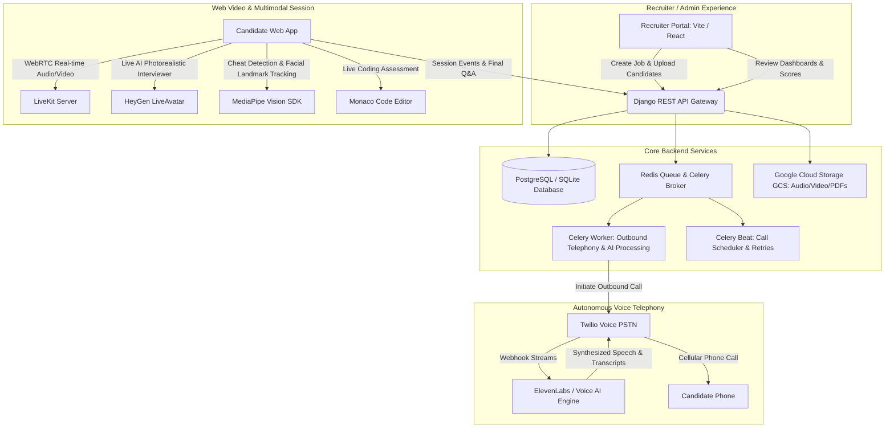
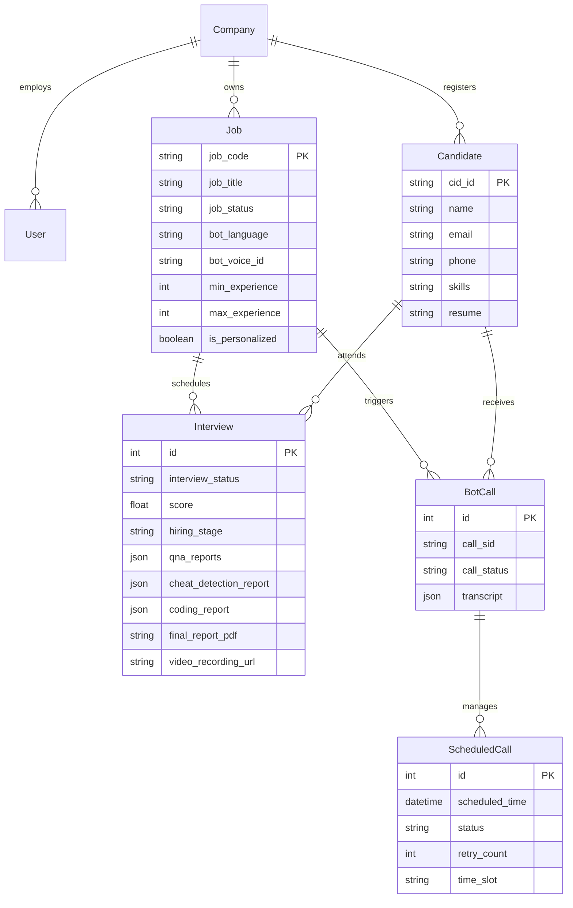
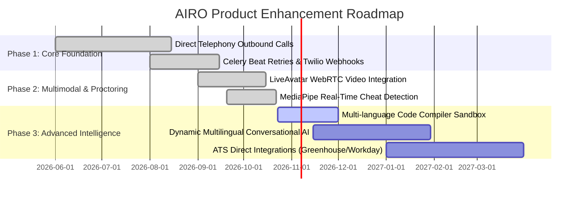

# Problem & Product Requirement Document (PRD)

**Project Name:** AIRO Platform (RingBot / Bot-Call)  
**Document Version:** 1.0.0  
**Status:** Approved / Active Baseline  
**Target Domain:** HR-Tech / Generative AI Recruiting & Autonomous Telephony / Multimodal Video Interviewing  
**Author / Stakeholders:** AIRO Engineering & Product Teams  

---

## 1. Executive Summary

The **AIRO Platform** (also referred to as *RingBot / Bot-Call*) is an end-to-end, enterprise-grade AI recruiting and candidate evaluation platform. It automates top-of-funnel talent screening by conducting realistic, conversational interviews across two complementary channels:
1. **Direct Outbound Telephonic Voice Calls:** Outbound PSTN/cellular phone calls orchestrated via Twilio and conversational speech synthesis (ElevenLabs / Azure Speech), requiring no software installation from candidates.
2. **Interactive Multimodal Web Video Sessions:** Browser-based interactive sessions featuring photorealistic generative video avatars (HeyGen LiveAvatar), real-time WebRTC audio/video (LiveKit), live Monaco coding sandboxes, and computer-vision-based anti-cheating proctoring (MediaPipe).

By combining job requisition parsing, resume information extraction, automated telephony dispatch, and LLM-driven scoring rubrics, AIRO reduces candidate screening turn-around time by upwards of 75% while removing interviewer bias and recruiter scheduling bottlenecks.

---

## 2. Problem Statement & Market Need

### 2.1 The Traditional Recruitment Bottleneck
High-volume recruitment and technical talent acquisition face severe systemic challenges:

1. **Recruiter Burnout & Screen Fatigue:**
   - Talent teams spend 60–70% of their working hours making repetitive 15–20 minute initial screening calls to verify basic qualifications, notice periods, communication fluency, and domain familiarity.
2. **High Candidate Drop-Off Due to Scheduling Friction:**
   - Multi-round email ping-pong to find matching time slots between busy candidates and recruiters leads to high drop-off rates and lost talent to competitors.
3. **Human Evaluator Bias & Inconsistency:**
   - Human interviewers evaluate candidates subjectively, influenced by mood, fatigue, and unconscious bias, resulting in variable evaluation standards for the same position.
4. **Widespread Resume Fraud & Remote Interview Cheating:**
   - Resumes increasingly contain exaggerated skills. In un-proctored remote assessments, impersonation, dual-monitor prompt assistance, and unauthorized third-party collaboration skew evaluation validity.
5. **High Cost Per Screen:**
   - Employing human screeners or specialized technical panel interviewers for early-stage filtering incurs unsustainable costs, particularly for large enterprise campaigns with thousands of applicants.

### 2.2 The AIRO Solution & Value Proposition
AIRO replaces the manual first-round phone screen and initial technical assessment with an autonomous, 24/7 AI-driven interview engine:
- **Zero Scheduling Overhead:** Candidates can be called immediately upon applying or can self-schedule a web avatar interview at their convenience.
- **Multimodal Flexibility:** Voice-only telephony for accessibility on basic mobile devices; full video avatar + coding sandbox for specialized technical roles.
- **Continuous AI Integrity Verification:** Real-time face tracking, head-pose estimation, multi-face presence detection, and identity verification.
- **Standardized, Transparent Scoring:** Every candidate is measured against the exact same rubric derived from the Job Description, generating objective scores, verbatim transcripts, and comprehensive PDF dossiers.

---

## 3. Target User Personas & Stakeholders

| Persona | Role | Key Pain Points | Platform Objective |
| :--- | :--- | :--- | :--- |
| **Enterprise Recruiter** | High-volume talent acquisition specialist | Overwhelmed by screening hundreds of applicants; spending hours dialing phone numbers. | Uploads candidate batches, launches automated bot campaigns, reviews ranked candidate shortlists. |
| **Hiring Manager / Tech Lead** | Department decision-maker | Interviewing unqualified candidates who passed basic resume keyword checks. | Accesses detailed performance scores, proctoring integrity flags, coding session replays, and call recordings. |
| **Candidate / Job Seeker** | Applicant for open requisitions | Anxious waiting periods, scheduling conflicts during work hours, cold rejections without feedback. | Receives timely outreach, completes interviews at convenient hours, experiences an engaging conversational format. |
| **Platform / Tenant Admin** | Org system administrator | Needs to manage team permissions, monitor credit consumption, and configure role access. | Controls multi-tenant company subdomains, user roles, permission scopes, and credit/billing limits. |

---

## 4. Product Scope & High-Level Architecture

---

## 5. Detailed Functional Requirements (FR)

### Module 1: Job Description & Requisition Management
* **FR-1.1: Multi-Modal JD Creation:**
  - The system shall allow recruiters to create job requisitions using three options:
    1. *File Upload:* Upload existing PDF/DOCX job descriptions, parsed automatically via NLP (`POST /interview/upload-jd/`).
    2. *Raw Text Entry:* Direct text submission parsed into structured fields (`POST /interview/upload-jobdescription/`).
    3. *AI Prompt Generation:* Generative AI creation of JD templates based on natural language prompts (`POST /interview/genrate-jd/`).
* **FR-1.2: Structured Field Extraction:**
  - Automatically extract and populate: Job Title, Experience Range (Min/Max), Work Mode (Remote/Hybrid/Onsite), Industry, Primary Skills, Secondary Skills, and Department.
* **FR-1.3: Requisition Lifecycle:**
  - Support job states: `Draft`, `Active`, `Inactive`, `On Hold`, and `Completed`.
* **FR-1.4: Link Expiry & Timeouts:**
  - Configurable candidate interview link validity windows (1 to 7 days; default 72 hours).

### Module 2: Candidate Management & Ingestion
* **FR-2.1: Ingestion Channels:**
  - Single resume parsing (`POST /interview/parse-candidate/`).
  - Bulk CSV/Excel spreadsheet upload with phone/email mapping (`POST /interview/upload-candidates/`).
  - Manual candidate form input (Name, Email, Phone, Location).
* **FR-2.2: Automated ID Generation:**
  - System must automatically assign standardized sequential identifiers (e.g., `CAND000042`).
* **FR-2.3: Contact Validation:**
  - Strict E.164 phone number formatting and email syntax validation prior to campaign scheduling.

### Module 3: Interview Campaign Configuration & Dispatch Engine
* **FR-3.1: 6-Step Stepper Workflow:**
  1. *Bot Type & Mode:* Select between Voice Telephony or Interactive Web Video (AI Templates vs. Personalized Resume Deep-Dive).
  2. *Language Selection:* Language code selection (`en-US`, `hi`, `hinglish`).
  3. *Job Requisition Linking:* Selection or generation of target Job ID.
  4. *Assessment Add-ons:* Optional activation of MCQ questions and/or Live Coding Sandbox.
  5. *Candidate Association:* Batch association of candidate IDs.
  6. *Review & Dispatch:* Execution of interview trigger (`POST /interview/create-interview/` or `POST /interview/create-bot-call/`).
* **FR-3.2: Dual Execution Dispatch Modes:**
  - *Mode A (Immediate Direct Dial):* Twilio automatically dials the candidate's phone number without candidate action (`email: false`).
  - *Mode B (Self-Schedule Link):* Candidate receives a branded email containing a secure single-use token to schedule or launch the session (`email: true`).
* **FR-3.3: Retries & Fallback Scheduling:**
  - Celery Beat background scheduler handles unattended calls with up to 3 automated retry attempts over predefined time slots.

### Module 4: Autonomous Telephonic Voice Bot (Twilio + ElevenLabs)
* **FR-4.1: Outbound Calling:**
  - Programmatic dialing via Twilio REST API with custom TwiML generation.
* **FR-4.2: Conversational Dialogue Management:**
  - AI bot greets candidate with the configured interviewer persona (e.g., *Luna*).
  - Evaluates candidate spoken answers in real-time and asks dynamic follow-up clarification questions.
* **FR-4.3: Telephony Webhooks & Call Audio Archival:**
  - Full recording of call audio stored securely in GCS.
  - Webhooks capture call status transitions (`initiated`, `ringing`, `in-progress`, `completed`, `busy`, `no-answer`).
* **FR-4.4: Transcript Generation:**
  - Turn-by-turn speaker-diarized transcript generation with millisecond timestamps.

### Module 5: Interactive Web Video Interview & Proctoring Engine
* **FR-5.1: Photorealistic Generative Avatar:**
  - Real-time video rendering of an AI interviewer avatar using HeyGen LiveAvatar SDK.
  - Low-latency lip-sync matching dynamic synthesized voice responses.
* **FR-5.2: Real-Time Anti-Cheating & Proctoring (MediaPipe Vision):**
  - Continuous webcam face detection and landmark verification.
  - Anomaly triggers recorded in `cheat_detection_report`:
    - *No face detected* (candidate walked away).
    - *Multiple faces detected* (unauthorized collaborator present).
    - *Gaze / Head pose deviation* (reading answers off a secondary screen).
    - *Browser tab switching / Window blur* events.
* **FR-5.3: Candidate Identity Verification:**
  - Capture candidate snapshot and government ID card image before session unlock (`candidate_image` and `candidate_identity`).

### Module 6: Live Coding & Technical Assessment Sandbox
* **FR-6.1: Embedded Monaco Code Editor:**
  - Multi-language syntax highlighting (Python, JavaScript, Java, C++, SQL).
* **FR-6.2: Test Case Execution & Behavioral Metrics:**
  - Automated evaluation against hidden and public unit test cases.
  - Keystroke dynamics, copy-paste event tracking, and total solution execution time captured in `coding_report`.

### Module 7: AI Evaluation, Scoring & PDF Dossier Generation
* **FR-7.1: Multi-Dimensional Rubric Scoring:**
  - Quantitative score (0 to 100) computed across core competencies:
    - Technical Knowledge & Core Skills
    - Communication Clarity & Professional Articulation
    - Problem-Solving Methodology & Relevance
    - Integrity & Proctoring Trust Score
* **FR-7.2: Automated Assessment PDF Generation:**
  - Compilation of a downloadable, executive-ready PDF report containing:
    - Candidate metadata & applied role
    - Overall score & hiring recommendation (`Hired`, `Shortlisted`, `On Hold`, `Rejected`)
    - Question-by-question transcript with individual evaluation notes
    - Proctoring integrity timeline and detected violation flags
    - Live audio/video playback links

### Module 8: Multi-Tenancy, Role-Based Access Control (RBAC) & Billing
* **FR-8.1: Multi-Tenant Tenant Isolation:**
  - Organizations isolated by subdomain, custom branding, and company-specific data partitions.
* **FR-8.2: Granular RBAC Permissions:**
  - Scoped roles (`PLATFORM` vs. `TENANT`) with permission matrices governing campaign creation, candidate data viewing, and credit management.
* **FR-8.3: Usage Credits & Quota Billing:**
  - Credit debiting per minute of phone interview, avatar generation, or AI JD parsing based on plan limits.

---

## 6. Non-Functional Requirements (NFR)

| Category | Requirement Specification | Metric / Target |
| :--- | :--- | :--- |
| **Voice Latency** | Turn-taking latency during telephone calls (silence detection to voice response). | **$\le$ 800 ms** (P95) |
| **Video Streaming Latency** | WebRTC video feed latency for LiveAvatar and candidate camera streams. | **$\le$ 250 ms** |
| **System Availability** | Core API, webhook receivers, and telephony routing uptime. | **99.9% Uptime** |
| **Concurrency & Throughput** | Simultaneous outbound phone calls and active WebRTC video sessions. | **100+ concurrent calls** per celery worker group |
| **Data Security & Privacy** | End-to-end TLS 1.3 encryption in transit; AES-256 encryption for media stored in GCS. | SOC2 / GDPR compliant PII handling |
| **Audio Reliability** | Automatic reconnection and call drop detection with automated redialing options. | Zero hanging telephony channels |
| **Device Compatibility** | Phone calls work on any standard carrier; web video supports modern Chrome, Edge, Safari, Firefox. | Cross-platform web & mobile browser support |

---

## 7. Data Models & Entity Relationships

---

## 8. Success Metrics & Key Performance Indicators (KPIs)

1. **Time-to-Screen Reduction:** Reduce candidate initial screening duration from 4–7 business days to **under 24 hours**.
2. **Interview Completion Rate:** Maintain a call/session completion rate of **$\ge$ 82%** for all dispatched invitations.
3. **Scoring Accuracy & Calibration:** $\ge$ 90% correlation between AI recommendation scores and subsequent human technical rounds.
4. **Recruiter Time Saved:** $\ge$ 20 recruiter hours saved per 100 applicants screened.
5. **Fraud Detection Efficacy:** 100% flag capture on multiple-face presence and tab-switch cheating attempts.

---

## 9. Assumptions, Constraints & Phased Roadmap

### Assumptions
- Candidates possess either a functional telephone connection or an internet-connected device with camera and microphone.
- Third-party speech and telephony providers (Twilio, ElevenLabs, LiveKit) maintain baseline API availability.

### Technical Constraints
- Browser WebRTC and MediaPipe require candidate permission grants for Camera and Microphone.
- Carrier-level telecom regulations (DND registries, STIR/SHAKEN caller ID authentication) apply to direct outbound phone calls.

### Product Roadmap

